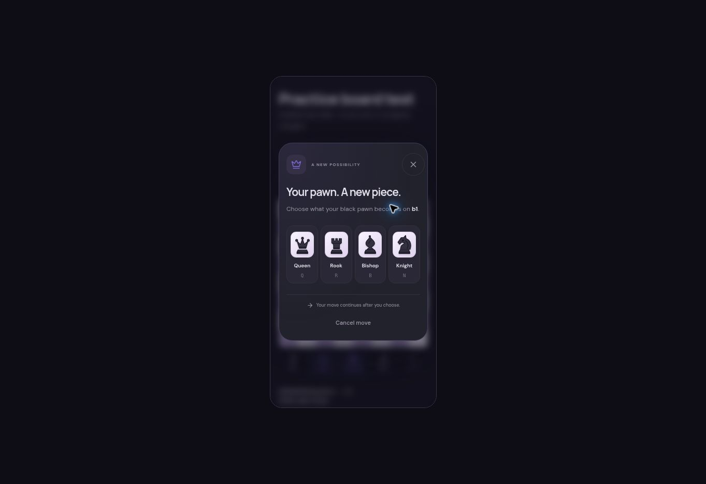

# Practice board and promotion update

The shared board uses a native modal promotion dialog with labeled queen, rook, bishop, and knight choices, high-contrast piece tiles, keyboard shortcuts, cancellation, and focus restoration. A choice is checked against the current position's legal promotions before submission; a changed position or timed-out game cannot apply a stale choice.

A checkmate symbol and label attach to the defeated king from the real chess.js position. The marker follows either orientation, disappears on undo/navigation, and does not appear for an ordinary check, stalemate, or material draw. The visual animation respects reduced-motion settings.

Practice games and arcade puzzle boards include view flipping, legal-hint and coordinate toggles, touch-friendly arrow/circle annotations, and clearing annotations. Flipping changes the view, not the player's assigned color or clock. Practice-game last moves and captured pieces come from the displayed game's move history. Earlier positions are labeled as replay positions, including after a finished game.

## Validation

- 109 automated tests passed, including four new board-rendering regression tests.
- TypeScript and the production build passed; the offline bundle and service worker were rebuilt with the same shared board and styles.
- Isolated browser checks at 390px and 320px: black promotion, knight underpromotion, cancel without a move, white promotion to checkmate, checkmate marker in both orientations, hints, coordinate hiding, arrows/circles, and annotation clearing.
- An e2–e4 drag produced the correct legal FEN. The browser driver reported a timeout, so the resulting board state was inspected separately to confirm the move.
- A real local practice session against Pip accepted e4, received a legal bot reply, reduced both clocks, displayed the two last-move squares, preserved the player's side when flipping, and returned to the start after a takeback.
- The temporary browser fixture was excluded from the application build and repository. Its image below uses test data, with no account or progress writes.

## Deployment

This change needs no database migration. It is based on the owner-panel deployment, independently of the pending signup-email-code branch. Publish using the standard repository checks and pinned Cloudflare Wrangler. Authentication secrets, owner identity, and existing database data do not need to change for this UI update. The original website remains separate.
